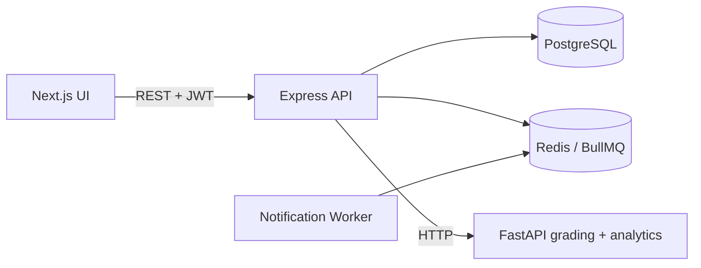

# Architecture and data ownership

Express owns authoritative learner, course, enrollment, progress, attempt, submission, grade and certificate records. FastAPI is stateless: it receives validated payloads and returns deterministic grading/analytics results; it does not maintain a duplicate system of record. Redis is ephemeral cache/job infrastructure, never authoritative business storage.

Key integrity controls: foreign keys, unique enrollment/progress constraints, check constraints, transaction around progress and attempt workflows, row locks around attempt counting and certificate issuance, and audit log table for governance events.
